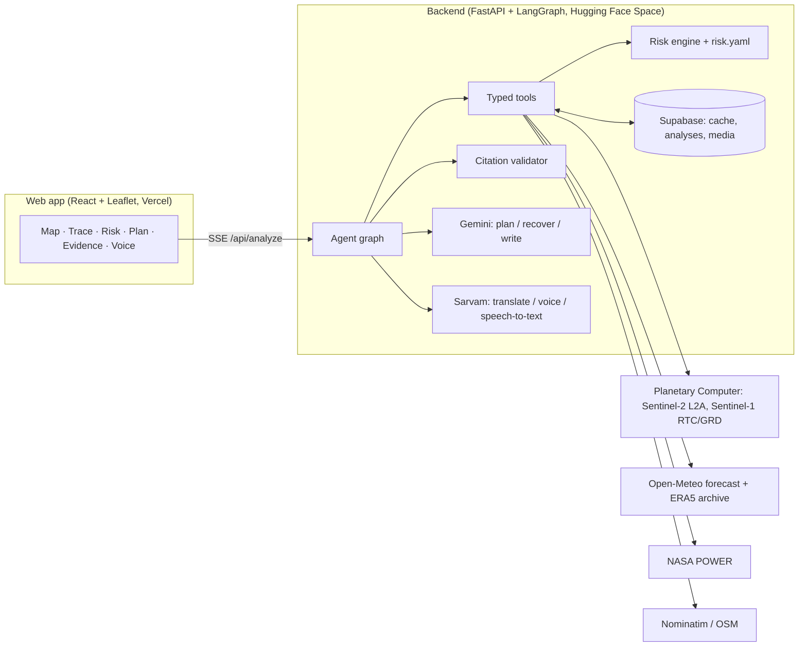

# KhetKavach — farm-level climate risk, in your language

**Click any farm in India and, in about 20 seconds, get a live 16-day drought, unseasonal-rain and heat risk for
that field, with a cited action plan read aloud in Hindi, Marathi and 7 more Indian languages.**
Every number on screen is traced to a satellite pass, a weather model or an official dataset.

- App: `https://<your-vercel-app>.vercel.app` (fill in after deploy)
- Backend health: `https://<user>-<space>.hf.space/health`
- Forge '26 · Theme 2 · Predictive Climate & Micro-Location Yield Engine

## 1. The problem and who it's for

Weather advice in India is mostly issued per district and in text. One district spans very different rainfall,
soil and crops, so a farmer gets advice that may not fit their own field, often too late and not in their language.
KhetKavach gives **farm-level** risk, **ahead of time**, **by voice in the farmer's language**, with the reasons shown.
Users: smallholder farmers, FPO / KVK field officers (batch view), agri-lenders and crop insurers (explainable score).

## 2. Features

| # | Feature | Status |
| --- | --- | --- |
| F1 | Map with satellite/street toggle, click-to-pick, village search, 500 m analysis box | Done |
| F2 | Sentinel-2 crop health (NDVI/NDMI now vs same weeks last year) via Planetary Computer | Done |
| F3 | Automatic Sentinel-1 radar fallback when optical images are cloudy | Done |
| F4 | Open-Meteo 16-day forecast + root-zone soil moisture | Done |
| F5 | 20-year normal from ERA5 (Open-Meteo archive), NASA POWER as backup | Done |
| F6 | Risk engine: drought / excess rain / heat, 0-100 + level + drivers, in code | Done |
| F7 | LangGraph agent with a live trace (plan, tool calls, retries, fallbacks) | Done |
| F8 | Cited action plan; validator rejects numbers not in tool outputs | Done |
| F9 | Sarvam translation + Bulbul v4 voice in 9 languages | Done |
| F10 | Graceful degradation: partial results with badges, never a crash | Done |
| F11 | Voice question in (Saaras speech-to-text) with a grounded, cited answer | Done |
| F12 | Crop-health overlay (change vs last year, green cover, true colour) + before/now slider | Done |
| F13 | Batch view: 1-20 farms as risk pins + sorted table + CSV | Done |
| F14 | District yield baseline from data.gov.in | Not built: the API returned timeouts / HTTP 502 when tested |
| F15 | Shareable risk-card link `/a/:id`, read back from the database | Done |

## 3. Architecture



**Data flow, click to voice:**
1. The user clicks a farm. The browser opens `GET /api/analyze` as Server-Sent Events, and the 500 m box pulses grey.
2. `check_location`: Nominatim reverse geocode. Ocean or outside India means a polite refusal, with no data calls.
3. `plan`: Gemini (function calling) proposes tool calls with reasons; code guarantees the required set.
4. `gather`: Sentinel-2, forecast and 20-year baseline run in parallel; each step streams to the trace.
5. `check` / `recover`: a cloudy box (< 60% clear) → 45-day window → Sentinel-1 radar; ERA5 down → NASA POWER.
6. `score`: the risk engine computes 3 scores from documented thresholds, and the box turns its risk colour.
7. `write`: Gemini writes a summary + 3-5 dated actions with `call_id.field` citations (JSON schema).
8. `validate`: every number must match a cited tool output, or the plan is rewritten once, then failing lines are dropped.
9. `localise`: Sarvam translates the checked English plan (numbers verified to survive) and Bulbul reads it aloud.
10. `save`: the analysis is stored in Supabase; `/a/:id` replays it read-only.

## 4. Agent design

LangGraph nodes: `check_location → plan → gather → check → (recover → gather, ≤ 2 rounds) → score → write →
validate (→ write once more) → localise → save`. The LLM does three jobs only (plan, recover, write), within a budget
of 4 calls per run. Each job has a deterministic fallback, so a Gemini outage gives a "Generated from rules" plan,
not a crash. Every node watches a 45 s run deadline.

| Tool | Allowed fallbacks |
| --- | --- |
| `get_optical_index` | same tool with a 45-day window, then `get_radar_index` |
| `get_radar_index` | Sentinel-1 GRD collection, then mark crop evidence missing |
| `get_forecast` | retry once, then mark forecast missing (heat and excess rain become "Not enough data") |
| `get_baseline` | NASA POWER, then mark baseline missing |
| `geocode` | coordinates only ("Unnamed place") |

**How the validator stops invented numbers** (`backend/app/agent/validator.py`): it extracts every number from the
summary and each action (dates and names like "Sentinel-2" excluded). Each must match a value in the evidence fields
that line cites, within 0.5 absolute or 2% relative. Citations must point to real `call_id.field`s, and dates must
fall inside the forecast window. A `call_id.field` written inside the text is also rejected. Unit tests include a
deliberately invented number.

**Demo controls:** with `DEMO_CONTROLS=true`, press Shift+D to simulate an outage of satellite, forecast,
baseline, llm or sarvam. The trace labels it "Simulated outage: … (demo control)".

## 5. Data provenance (no mock data)

| Data | Source | Link | Licence / terms |
| --- | --- | --- | --- |
| Optical satellite (NDVI, NDMI, true colour) | Sentinel-2 L2A via Microsoft Planetary Computer | planetarycomputer.microsoft.com/dataset/sentinel-2-l2a | Copernicus open licence |
| Radar fallback | Sentinel-1 RTC (GRD backup) via Planetary Computer | planetarycomputer.microsoft.com/dataset/sentinel-1-rtc | Copernicus open licence; RTC per PC terms |
| Forecast, soil moisture | Open-Meteo Forecast API | open-meteo.com/en/docs | CC BY 4.0, free non-commercial |
| 20-year normal | ERA5 via Open-Meteo Historical API | open-meteo.com/en/docs/historical-weather-api | CC BY 4.0 (Copernicus ERA5) |
| Backup normal | NASA POWER daily point API | power.larc.nasa.gov | NASA open data |
| Place names | Nominatim / OpenStreetMap | nominatim.openstreetmap.org | ODbL; ≤ 1 request/s, cached |
| Translation, voice, speech-to-text | Sarvam AI (sarvam-translate:v1, bulbul:v4-flash, saaras:v4) | docs.sarvam.ai | Commercial API (team key) |
| Agent LLM | Google Gemini API (gemini-3.5-flash-lite) | ai.google.dev | Gemini API terms |

**This repository contains no mock data, fixture JSON or random-number values.** Every number on screen comes from a
live API call, or from a cache entry of a real response shown with its original fetch time and "(cached)". Unit
tests feed hand-picked inputs to the formulas; the live tests (`pytest -m live`) call the real providers.

## 6. Risk method

`lin(x, a, b) = clamp((x − a) / (b − a) × 100, 0, 100)`. All thresholds and weights live in
`backend/app/risk.yaml`. They are **defaults to be reviewed by an agronomist**.

- **Drought** = 0.30·lin(water deficit, 10, 60 mm) + 0.15·lin(longest dry spell, 5, 14 days)
  + 0.20·lin(0.30 − root-zone soil moisture, 0, 0.18) + 0.20·lin(−ΔNDMI, 0.02, 0.15) [radar: lin(−ΔVH, 0.5, 3 dB)]
  + 0.15·lin(−past-30-day rain anomaly, 20, 80%). The dry-spell term is set to 0, with its weight moved to the
  deficit term, when the normal rain for the next 16 days is under 10 mm. ×1.15 at wheat crown-root initiation /
  flowering and mustard flowering.
- **Excess / unseasonal rain** = 0.45·lin(max 3-day rain, 20, 80) + 0.25·lin(rain − normal, 10, 60)
  + 0.15·lin(max rain probability next 7 days, 40, 90) + 0.15·lin(soil moisture, 0.35, 0.45); ×1.3 at flowering
  and maturity/harvest.
- **Heat** = 0.50·lin(hot days ≥ stage threshold, 0, 6) + 0.30·lin(peak − threshold, 0, 5)
  + 0.20·lin(mean max − normal, 1, 5). Thresholds: wheat 32/34 °C, mustard 30/33 °C, gram 32/35 °C (sensitive/other),
  35 °C if the crop is unknown.
- Missing evidence: its weight is dropped and the rest rescaled; under 50% available reads "Not enough data".
  Levels: 0-33 Low, 34-66 Moderate, 67-100 High. Confidence drops a step for radar-only, no satellite, no baseline,
  no forecast, or crop "Not sure".

## 7. Setup

Prerequisites: Python 3.11 (`uv` recommended), Node 20.

```bash
cp .env.example .env            # fill in the keys (never commit .env)
# Supabase: run backend/sql/schema.sql in the SQL editor once

cd backend
uv venv --python 3.11 .venv && uv pip install --python .venv/bin/python -r requirements.txt pytest pytest-asyncio
.venv/bin/uvicorn app.main:app --port 7860 --reload        # backend on http://localhost:7860
.venv/bin/python -m pytest                                 # unit tests (no network)
.venv/bin/python -m pytest -m live                         # live tests against the real APIs
.venv/bin/python scripts/spike_openmeteo.py                # any spike_*.py prints real provider output

cd ../frontend
npm install && npm run dev                                 # app on http://localhost:5173
```

## 8. Limitations and roadmap

- Thresholds are documented defaults, not yet calibrated by an agronomist; the irrigation status of a field is unknown.
- A 500 m box can mix several fields; built-up or water boxes get a warning note.
- Free tiers: Gemini and Open-Meteo rate limits; Sarvam credit (cached by text hash).
- District yield (F14) is waiting on the data.gov.in API, which returned timeouts / HTTP 502 during the build.
- Roadmap (P2): SMS/WhatsApp delivery, IoT soil sensors, insurer API, draw-your-own field boundary.

## 9. Team

| Member | Owns |
| --- | --- |
| A: Geo & data lead | Satellite + radar fetchers, baseline, risk engine, data provenance |
| B: Agent & backend lead | FastAPI, LangGraph loop, tool layer, validator, Gemini + Sarvam, backend deploy |
| C: Frontend & demo lead | Map, trace panel, risk card, voice player, batch view, deck, video |
